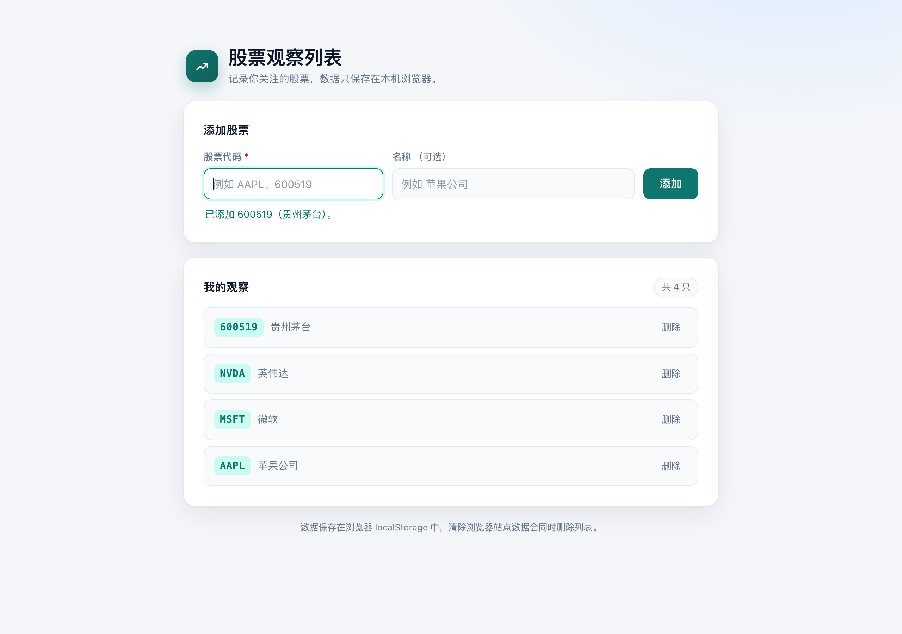

# 股票观察列表

一个零依赖的纯静态股票观察列表网页：添加、删除股票，数据自动保存在浏览器本地（localStorage），无需后端或账号。



## 功能

- **添加股票**：股票代码必填、名称可选；代码不区分大小写，重复时会提示
- **删除股票**：点击列表项右侧的「删除」立即移除
- **本地保存**：刷新或重新打开页面后列表仍在
- **响应式布局**：桌面与手机均可用，跟随系统切换浅色 / 深色主题

## 起卦预测

`divination.html` 记录 2026-11-01 戌时以梅花易数时间起卦、推演黄金短期是否见底的完整卦象、数理与结论，观察列表页底部提供入口。传统术数推演，仅供参考，不构成任何投资建议。

## 本地运行

直接双击打开 `index.html` 即可；也可以启动一个静态文件服务器：

```bash
python3 -m http.server 8000
```

然后访问 <http://localhost:8000>。

## 项目结构

```text
.
├── index.html
├── divination.html
├── assets/
│   ├── app.js
│   ├── divination.css
│   ├── favicon.svg
│   └── styles.css
├── docs/
│   └── screenshots/
└── README.md
```

## 说明

数据只保存在当前浏览器的 localStorage（键名 `stock-watchlist.v1`）中，不会上传到任何服务器；清除浏览器站点数据会同时清空观察列表。
